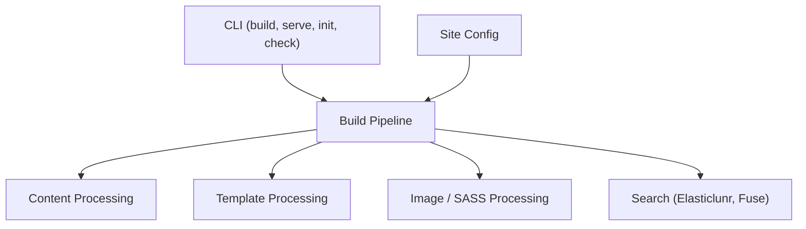

# getzola/zola

> Static site generator in a single binary, with the Tera template engine, for blogs and documentation.

## The problem
Publishing a documentation site or a blog without depending on a heavy toolchain or an annoying template engine.

## What it actually does
Turns Markdown and templates into HTML: syntax highlighting, Sass, image processing, taxonomies, pagination, serverless search, link checker, live reload, themes, basic multilingual support. Subcommands: build, serve, init, check.

## How it is wired
Diagram based on the code's own diagram, simplified.

## Trying it
No command in the README: see the Zola documentation (docs/content folder).

## Cost and gotchas
Free (EUPL-1.2). Tera templates are specific to Zola. Multilingual support is described as "basic".

## What it is not
Not a CMS: no editing interface. Not a web application framework. The README, very short, points to the documentation.

## Alternatives
- Hugo: cited as the tool the author left because of its template engine.

## For you
Worth watching: handy for publishing ML project documentation as a single binary, without Node or Python, if you don't already have a tool in place.
