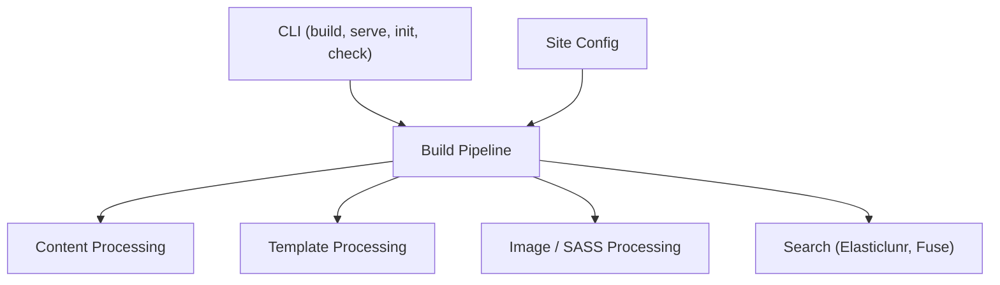

# getzola/zola

> Générateur de sites statiques en un seul binaire, avec moteur de templates Tera, pour blogs et documentation.

## Le problème
Publier un site de documentation ou un blog sans dépendre d'une chaîne d'outils lourde ni d'un moteur de templates pénible.

## Ce que ça fait vraiment
Transforme du Markdown et des templates en HTML : coloration syntaxique, Sass, traitement d'images, taxonomies, pagination, recherche sans serveur, vérificateur de liens, rechargement en direct, thèmes, multilingue basique. Sous-commandes : build, serve, init, check.

## Comment c'est branché
Schéma d'après le diagramme du code, simplifié.

## Essayer
Aucune commande dans le README : voir la documentation Zola (dossier docs/content).

## Coût et pièges
Gratuit (EUPL-1.2). Les templates Tera sont propres à Zola. Le multilingue est décrit comme « basique ».

## Ce que ce n'est pas
Pas un CMS : pas d'interface d'édition. Pas un framework d'application web. Le README, très court, renvoie à la documentation.

## Alternatives
- Hugo : cité comme l'outil que l'auteur a quitté à cause de son moteur de templates.

## Pour toi
À surveiller : pratique pour publier une documentation de projet ML en un binaire, sans Node ni Python, si tu n'as pas déjà un outil en place.

