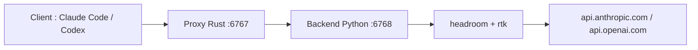

# gglucass/headroom-desktop

> System tray application that compresses Claude Code and Codex prompts to reduce tokens.

## The problem
Tool outputs, logs and repetitive text bloat every prompt and eat into the subscription quota.

## What it actually does
Places a local proxy between the client (Claude Code, Codex, OpenCode, Grok Build) and the API. A Python backend compresses tool outputs and returns the original on demand. Modifies the clients' configurations with a backup, then removes the changes on exit. Displays the savings.

## How it is wired


## Trying it
```bash
brew install --cask headroom
curl -s http://127.0.0.1:6767/stats
```

## Cost and gotchas
Paid subscription (7-day trial, from 4 dollars per month) and an account required. About 3 GB of Python runtime. Edits `~/.claude/settings.json`, `~/.codex/config.toml` and the shell profile.

## What it is not
Not entirely open: only the shell is under MIT, the account and the backend are private. Code compression is deliberately cautious.

## Alternatives
No alternative named in the README.

## For you
Worth watching: the token savings matter for heavy use of coding agents, but a paid proxy that modifies your configs requires trust.
