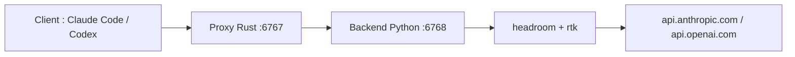

# gglucass/headroom-desktop

> Application de barre système qui compresse les prompts de Claude Code et Codex pour réduire les jetons.

## Le problème
Sorties d'outils, logs et texte répétitif gonflent chaque prompt et consomment le quota de l'abonnement.

## Ce que ça fait vraiment
Place un proxy local entre le client (Claude Code, Codex, OpenCode, Grok Build) et l'API. Un backend Python compresse les sorties d'outils et rend l'original à la demande. Modifie les configurations des clients avec sauvegarde, puis les retire à la sortie. Affiche les économies.

## Comment c'est branché


## Essayer
```bash
brew install --cask headroom
curl -s http://127.0.0.1:6767/stats
```

## Coût et pièges
Abonnement payant (essai de 7 jours, dès 4 dollars par mois) et compte requis. Environ 3 Go de runtime Python. Édite `~/.claude/settings.json`, `~/.codex/config.toml` et le profil shell.

## Ce que ce n'est pas
Ce n'est pas entièrement libre : seule la coquille est sous MIT, le compte et le backend sont privés. La compression du code est volontairement prudente.

## Alternatives
Aucune alternative nommée dans le README.

## Pour toi
À surveiller : les gains de jetons intéressent un usage intensif d'agents de code, mais un proxy payant qui modifie tes configs demande de la confiance.

