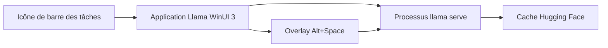

# ggml-org/Llama-Windows

> Windows 11 taskbar app to run llama.cpp models locally.

## The problem
Running a local LLM on Windows means handling llama.cpp, model downloads and a chat interface by hand.

## What it actually does
A WinUI 3 application drives a `llama serve` process through its REST API. It uses your llama.exe or downloads one, offers models from the Hugging Face Hub and shows the memory estimate per context length, read from the GGUF header. An Alt+Space shortcut opens a chat window on the loaded model.

## How it is wired


## Trying it
```bash
dotnet build LlamaApp.csproj -c Release -r win-x64   -p:Platform=x64
dotnet test LlamaApp.Tests/LlamaApp.Tests.csproj -c Release
```

## Cost and gotchas
Free. Normal installation is through the .msixbundle from Releases; building requires the .NET 10 SDK on Windows. Performance depends on your machine and the chosen model.

## What it is not
Not an inference engine: it relies on llama.cpp. Not for Linux or macOS (a separate Mac version exists). No telemetry, but outgoing HTTP requests to download models and check for updates.

## Alternatives
Llama for Mac: the original version, cited in the README, for macOS.

## For you
Adopt it if you are on Windows 11: run GGUF models locally from the taskbar, in a repository of the organization that maintains llama.cpp.
