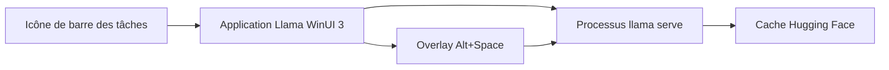

# ggml-org/Llama-Windows

> Application de barre des tâches Windows 11 pour lancer des modèles llama.cpp en local.

## Le problème
Faire tourner un LLM local sous Windows suppose de gérer à la main llama.cpp, les téléchargements de modèles et une interface de chat.

## Ce que ça fait vraiment
Une application WinUI 3 pilote un processus `llama serve` via son API REST. Elle utilise ton llama.exe ou en télécharge un, propose des modèles du Hugging Face Hub et affiche l'estimation de mémoire par longueur de contexte, lue dans l'en-tête GGUF. Un raccourci Alt+Espace ouvre une fenêtre de chat sur le modèle chargé.

## Comment c'est branché


## Essayer
```bash
dotnet build LlamaApp.csproj -c Release -r win-x64   -p:Platform=x64
dotnet test LlamaApp.Tests/LlamaApp.Tests.csproj -c Release
```

## Coût et pièges
Gratuit. L'installation normale se fait par le .msixbundle des Releases ; la compilation demande le SDK .NET 10 sous Windows. La puissance dépend de ta machine et du modèle choisi.

## Ce que ce n'est pas
Pas un moteur d'inférence : il s'appuie sur llama.cpp. Pas pour Linux ni macOS (il existe une version Mac séparée). Aucune télémétrie, mais des requêtes HTTP sortantes pour télécharger les modèles et vérifier les mises à jour.

## Alternatives
Llama for Mac : la version d'origine, citée dans le README, pour macOS.

## Pour toi
À adopter si tu es sous Windows 11 : lancer des modèles GGUF en local depuis la barre des tâches, sous un dépôt de l'organisation qui maintient llama.cpp.

