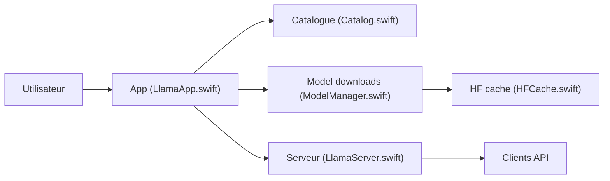

# ggml-org/Llama-macOS

> macOS menu bar app that runs local LLMs via llama.cpp, for Mac users.

## The problem
Installing, configuring and serving a GGUF model with llama.cpp means handling binaries, settings and downloads by hand.

## What it actually does
- Starts a local OpenAI-compatible server at `http://localhost:9931/v1` and a chat WebUI.
- Uses llama.cpp if it is installed, otherwise downloads a prebuilt binary.
- Installs GGUF models from Hugging Face (cache shared with llama.cpp), and recommends the ones suited to your machine.
- Loads a model on demand and unloads it when idle; per-model settings can be overridden in `~/.config/llama/models.user.ini`.

## How it is wired


## Trying it
```bash
brew install --cask llama-app
curl http://localhost:9931/v1/models
curl http://localhost:9931/v1/chat/completions -H "Content-Type: application/json" -d '{"model": "ggml-org/gpt-oss-20b-GGUF:MXFP4", "messages": [{"role": "user", "content": "Hello"}]}'
```

## Cost and gotchas
Free; the Mac's RAM limits the model size. Network access ("This network") exposes the server without a password: avoid it outside a trusted network, especially with agent mode. A key can be added via `extraServerArgs`.

## What it is not
Not cross-platform: macOS only. Not a model trainer nor a multi-user production server.

## Alternatives
llama.cpp itself, which it uses underneath.

## For you
Adopt if you are on a Mac: prototype locally with an OpenAI-compatible API, without sending data out, from the llama.cpp team.
