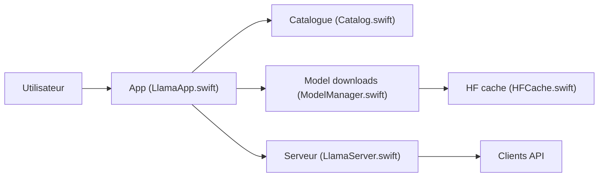

# ggml-org/Llama-macOS

> Application macOS de barre de menus qui lance des LLM locaux via llama.cpp, pour utilisateurs de Mac.

## Le problème
Installer, configurer et servir un modèle GGUF avec llama.cpp demande de gérer binaires, réglages et téléchargements à la main.

## Ce que ça fait vraiment
- Démarre un serveur local compatible OpenAI sur `http://localhost:9931/v1` et une WebUI de chat.
- Utilise llama.cpp s'il est installé, sinon télécharge un binaire précompilé.
- Installe des modèles GGUF depuis Hugging Face (cache partagé avec llama.cpp), recommande ceux adaptés à ta machine.
- Charge un modèle à la demande et le décharge à l'inactivité ; réglages par modèle surchargeables dans `~/.config/llama/models.user.ini`.

## Comment c'est branché


## Essayer
```bash
brew install --cask llama-app
curl http://localhost:9931/v1/models
curl http://localhost:9931/v1/chat/completions -H "Content-Type: application/json" -d '{"model": "ggml-org/gpt-oss-20b-GGUF:MXFP4", "messages": [{"role": "user", "content": "Hello"}]}'
```

## Coût et pièges
Gratuit ; la RAM du Mac limite la taille des modèles. L'accès réseau (« This network ») expose le serveur sans mot de passe : à éviter hors réseau de confiance, surtout avec le mode agent. Une clé peut s'ajouter via `extraServerArgs`.

## Ce que ce n'est pas
Pas multiplateforme : macOS seulement. Pas un entraîneur de modèle ni un serveur de production multi-utilisateur.

## Alternatives
llama.cpp lui-même, qu'elle utilise en dessous.

## Pour toi
À adopter si tu es sur Mac : prototyper en local avec une API compatible OpenAI, sans envoi de données, issu de l'équipe de llama.cpp.

