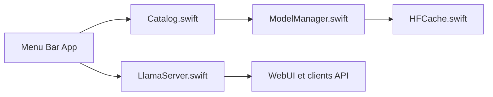

# ggml-org/LlamaBarn

> macOS menu bar app that serves local LLMs through llama.cpp on an OpenAI-compatible API.

## The problem
Launching llama.cpp, choosing GGUF models and tuning the settings suited to your Mac takes manual work.

## What it actually does
Starts a local server at `http://localhost:9931/v1`, uses llama.cpp if installed (otherwise downloads a binary). Installs any GGUF from Hugging Face into the shared cache, recommends models suited to the hardware, loads models on demand and unloads them when idle. Built-in WebUI. User settings in `~/.config/llama/models.user.ini`.

## How it is wired


## Trying it
```bash
brew install --cask llama-app
curl http://localhost:9931/v1/models
curl http://localhost:9931/v1/chat/completions -H "Content-Type: application/json" -d '{"model": "ggml-org/gpt-oss-20b-GGUF:MXFP4", "messages": [{"role": "user", "content": "Hello"}]}'
```

## Cost and gotchas
Free; model size weighs on disk and memory. The server has no password: the "This network" option exposes it to the whole network, to be avoided outside a trusted network (Tailscale suggested).

## What it is not
Not cross-platform (macOS). Not an inference engine: it relies on llama.cpp.

## Alternatives
No alternative named in the README.

## For you
Adopt it if you have a Mac: maintained by the ggml organization, MIT, a good way to get a local OpenAI-compatible API with no configuration.
