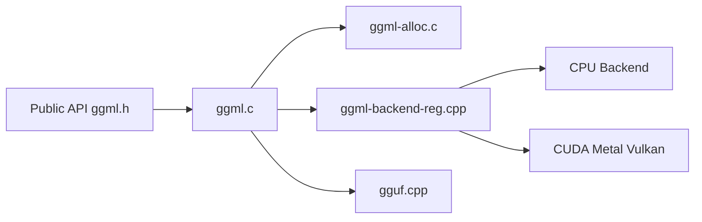

# ggml-org/ggml

> Dependency-free C/C++ tensor library, the foundation of llama.cpp, for portable inference.

## The problem
Running models on CPU, GPU, NPU or in the browser without embedding a full framework.

## What it actually does
Tensor core (`ggml.c`), allocator, 2 to 8-bit quantization (plus MXFP4, NVFP4), GGUF format, optimizers, and pluggable backends: CPU/SIMD, CUDA, Metal, Vulkan, OpenCL, SYCL, CANN, BLAS. An RPC module enables remote execution; Python CFFI bindings exist.

## How it is wired


## Trying it
```bash
git clone https://github.com/ggml-org/ggml
cd ggml
mkdir build && cd build
cmake ..
cmake --build . --config Release -j 8
```

## Cost and gotchas
Free. You must enable the backends you want through CMake options. Low level: you write compute graphs by hand.

## What it is not
Not a ready-to-use model runner: to chat with an LLM, you need an application built on top of it.

## Alternatives
No alternative named in the README.

## For you
Adopt if you optimize or embed local inference; otherwise use a tool built on it directly.
