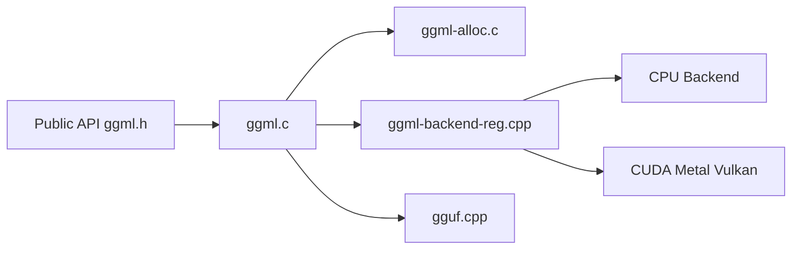

# ggml-org/ggml

> Bibliothèque de tenseurs en C/C++ sans dépendance, base de llama.cpp, pour l'inférence portable.

## Le problème
Exécuter des modèles sur CPU, GPU, NPU ou navigateur sans embarquer un framework complet.

## Ce que ça fait vraiment
Noyau de tenseurs (`ggml.c`), allocateur, quantification 2 à 8 bits (plus MXFP4, NVFP4), format GGUF, optimiseurs, et backends enfichables : CPU/SIMD, CUDA, Metal, Vulkan, OpenCL, SYCL, CANN, BLAS. Un module RPC permet l'exécution distante ; des liaisons Python CFFI existent.

## Comment c'est branché


## Essayer
```bash
git clone https://github.com/ggml-org/ggml
cd ggml
mkdir build && cd build
cmake ..
cmake --build . --config Release -j 8
```

## Coût et pièges
Gratuit. Il faut activer les backends voulus par options CMake. Bas niveau : tu écris des graphes de calcul à la main.

## Ce que ce n'est pas
Pas un exécuteur de modèles prêt à l'emploi : pour discuter avec un LLM, il faut une application construite dessus.

## Alternatives
Aucune alternative nommée dans le README.

## Pour toi
Adopter si tu optimises ou embarques de l'inférence locale ; sinon utilise directement un outil basé dessus.

