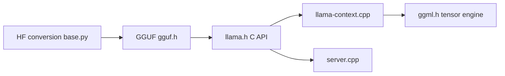

# ggml-org/llama.cpp

> C/C++ LLM and VLM inference engine, with quantization, compatible with the OpenAI server, and numerous backends.

## The problem
Running a large model locally requires a significant amount of memory and inference code that is specifically tailored to the hardware.

## What it actually does
C/C++ implementation without dependencies, built on the ggml library. It loads models in GGUF format, quantizes them (1.5 to 8 bits), and generates output via a command-line interface or an HTTP server (OpenAI-compatible API, embeddings, reranking, web interface). Backends: Metal, CUDA, HIP, Vulkan, SYCL, ARM, x86, and RISC-V. Hybrid CPU and GPU inference allows exceeding VRAM limitations.

## How it is wired


## Trying it
```bash
curl -LsSf https://llama.app/install.sh | sh
llama cli -hf ggml-org/Qwen3.5-0.8B-GGUF
llama serve -hf ggml-org/Qwen3.5-0.8B-GGUF
```

## Cost and gotchas
Free. The amount of RAM or VRAM depends on the chosen model and its quantization. Models can be downloaded from Hugging Face.

## What it is not
This is not a training framework; it's for inference. The command names in the README are different from those in previous versions.

## Alternatives
No alternative is specified in the README file.

## For you
To be adopted for serving quantized models locally with an OpenAI-compatible API: a guide for inference on modest hardware.
