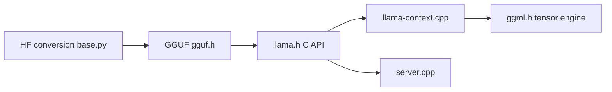

# ggml-org/llama.cpp

> Moteur d'inférence LLM et VLM en C/C++, avec quantification, serveur compatible OpenAI et nombreux backends.

## Le problème
Faire tourner un grand modèle en local demande beaucoup de mémoire et du code d'inférence adapté à chaque matériel.

## Ce que ça fait vraiment
Implémentation C/C++ sans dépendances, bâtie sur la bibliothèque ggml. Elle charge des modèles au format GGUF, les quantifie (1,5 à 8 bits) et génère via une CLI ou un serveur HTTP (API compatible OpenAI, embeddings, reranking, interface web). Backends : Metal, CUDA, HIP, Vulkan, SYCL, ARM, x86 et RISC-V. L'inférence hybride CPU et GPU permet de dépasser la VRAM.

## Comment c'est branché


## Essayer
```bash
curl -LsSf https://llama.app/install.sh | sh
llama cli -hf ggml-org/Qwen3.5-0.8B-GGUF
llama serve -hf ggml-org/Qwen3.5-0.8B-GGUF
```

## Coût et pièges
Gratuit. La RAM ou VRAM dépend du modèle choisi et de sa quantification. Les modèles se téléchargent depuis Hugging Face.

## Ce que ce n'est pas
Pas un framework d'entraînement : c'est de l'inférence. Les noms de commandes du README diffèrent de ceux des anciennes versions.

## Alternatives
Aucune alternative nommée dans le README.

## Pour toi
À adopter pour servir des modèles quantifiés en local avec une API OpenAI-compatible : référence pour l'inférence sur machine modeste.

