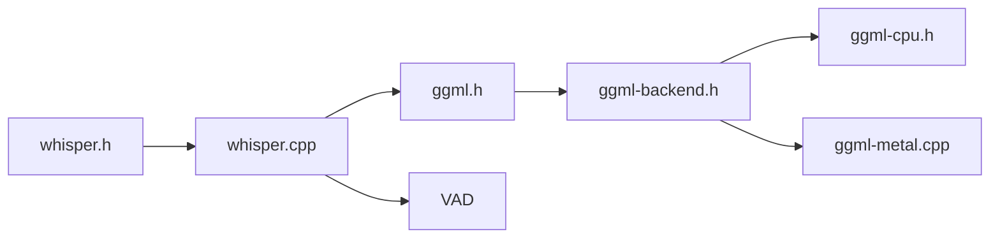

# ggml-org/whisper.cpp

> Offline inference of the Whisper speech recognition model in C/C++, for CPU, GPU, and mobile devices.

## The problem
Running Whisper typically requires Python, PyTorch, and a GPU; this makes it difficult to deploy on mobile devices or lightweight servers.

## What it actually does
Loads a model in the ggml format, accepts 16 kHz PCM audio, and returns time-stamped text segments. Uses full-integer quantization, Silero VAD, experimental tinydiarize, and an OpenAI-type HTTP server. Backends include Metal, CUDA, Vulkan, OpenVINO, Core ML, and AMD NPU. Supports Go, Java, JS, Ruby, Rust, .NET, and Python (third-party).

## How it is wired


## Trying it
```bash
sh ./models/download-ggml-model.sh base.en
cmake -B build
cmake --build build -j --config Release
./build/bin/whisper-cli -f samples/jfk.wav
```

## Cost and gotchas
Free. whisper-cli only accepts 16-bit WAV files (convert using ffmpeg). Memory usage ranges from approximately 273 MB (small) to 3.9 GB (large). The README file is partially truncated in the middle (sections on NPU/ffmpeg are mixed).

## What it is not
No training required: only inference. The real-time streaming is described as "naive" in the README.

## Alternatives
No alternative is specified in the README file.

## For you
Recommended: local transcription without a GPU required, direct brick for a voice/RAG pipeline; test first on a short file.
