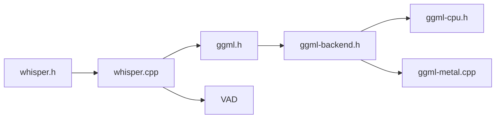

# ggml-org/whisper.cpp

> Inférence hors ligne du modèle de reconnaissance vocale Whisper en C/C++, pour CPU, GPU et mobiles.

## Le problème
Faire tourner Whisper demande d'ordinaire Python, PyTorch et un GPU ; difficile à embarquer sur mobile ou serveur léger.

## Ce que ça fait vraiment
Charge un modèle converti au format ggml, prend de l'audio PCM 16 kHz et renvoie des segments de texte horodatés. Quantification entière, VAD (Silero), tinydiarize expérimental, serveur HTTP de type OpenAI, backends Metal, CUDA, Vulkan, OpenVINO, Core ML, NPU AMD. Bindings Go, Java, JS, Ruby, Rust, .NET, Python (tiers).

## Comment c'est branché


## Essayer
```bash
sh ./models/download-ggml-model.sh base.en
cmake -B build
cmake --build build -j --config Release
./build/bin/whisper-cli -f samples/jfk.wav
```

## Coût et pièges
Gratuit. whisper-cli n'accepte que du WAV 16 bits (convertir avec ffmpeg). Mémoire de ~273 Mo (tiny) à ~3,9 Go (large). README partiellement tronqué au milieu (sections NPU/ffmpeg mélangées).

## Ce que ce n'est pas
Pas d'entraînement : inférence seulement. Le streaming temps réel est qualifié de « naïf » par le README.

## Alternatives
Aucune alternative nommée dans le README.

## Pour toi
À adopter : transcription locale sans GPU obligatoire, brique directe pour un pipeline voix/RAG ; à tester d'abord sur un fichier court.

