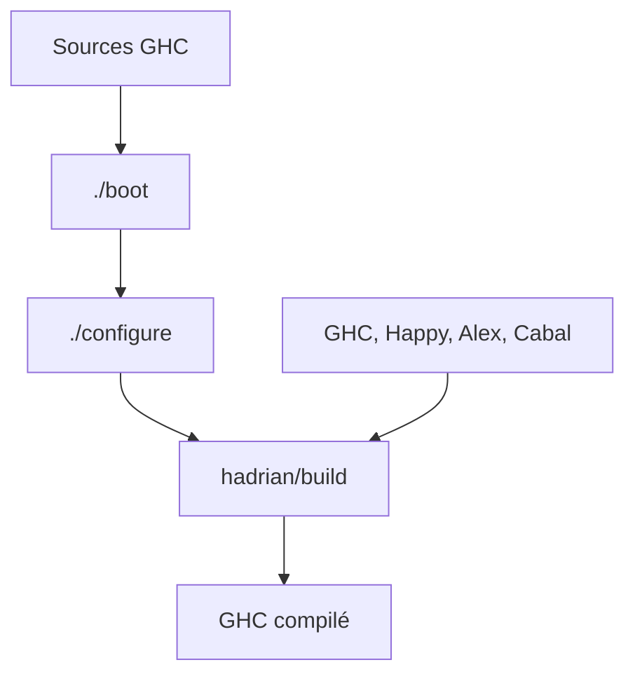

# ghc/ghc

> Source of the Glasgow Haskell Compiler, compiler and interactive environment for the Haskell language.

## The problem
Anyone contributing to GHC or building it from source needs an entry point into the compiler tree.

## What it actually does
The repository contains the compiler, its "boot" libraries and the Hadrian build system. The README guides you through fetching the sources, compiling, the reference GitLab repository, bug reports and development. GHC is written in Haskell: you already need a GHC to build it.

## How it is wired
Simplified diagram based on the sheet, no diagram provided.


## Trying it
```bash
./boot
./configure
hadrian/build -j4
```

## Cost and gotchas
Free. Compilation is long (profiling included). You need an existing GHC, Happy, Alex and Cabal; cloning from GitHub requires special configuration (the reference repository is on GitLab). License not identified by GitHub.

## What it is not
Not an installer for users: to use Haskell you download an already built version. Not a project primarily hosted on GitHub.

## Alternatives
No alternative cited in the README.

## For you
Ignore: compiling GHC is contributor work, unrelated to your field.
