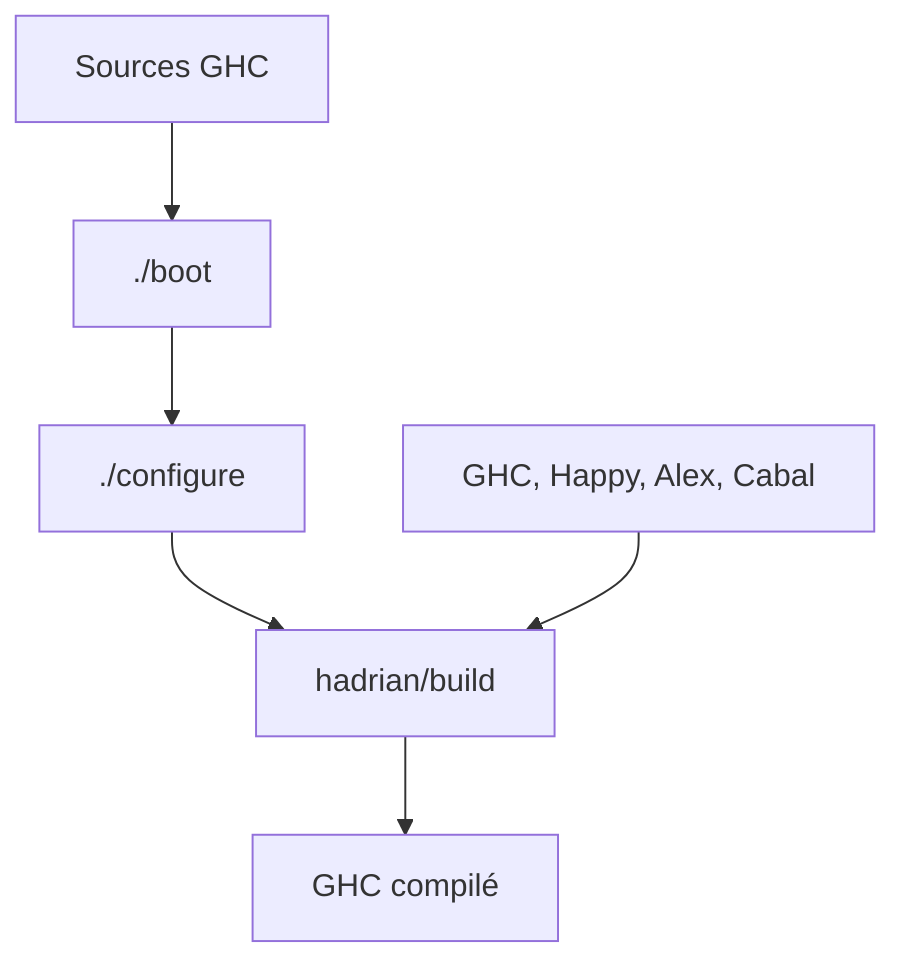

# ghc/ghc

> Source du Glasgow Haskell Compiler, compilateur et environnement interactif du langage Haskell.

## Le problème
Pour qui contribue à GHC ou le construit depuis les sources, il faut un point d'entrée vers l'arbre du compilateur.

## Ce que ça fait vraiment
Le dépôt contient le compilateur, ses bibliothèques « boot » et le système de build Hadrian. Le README guide la récupération des sources, la compilation, le dépôt GitLab de référence, les rapports de bugs et le développement. GHC est écrit en Haskell : il faut déjà un GHC pour le construire.

## Comment c'est branché
Schéma simplifié d'après la fiche, sans diagramme fourni.


## Essayer
```bash
./boot
./configure
hadrian/build -j4
```

## Coût et pièges
Gratuit. La compilation est longue (profilage inclus). Il faut un GHC existant, Happy, Alex et Cabal ; le clone depuis GitHub exige une configuration spéciale (dépôt de référence sur GitLab). Licence non identifiée par GitHub.

## Ce que ce n'est pas
Pas un installeur pour utilisateurs : pour utiliser Haskell on télécharge une version déjà construite. Pas un projet hébergé en priorité sur GitHub.

## Alternatives
Aucune alternative citée dans le README.

## Pour toi
Ignorer : compiler GHC est un travail de contributeur, sans rapport avec ton métier.

