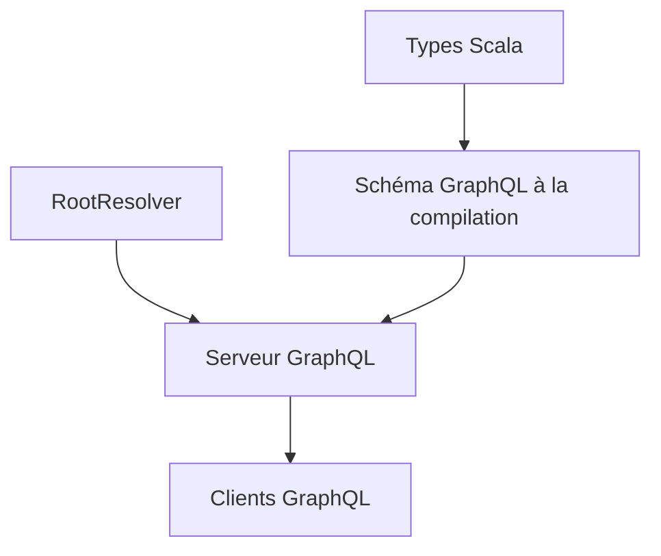

# ghostdogpr/caliban

> Purely functional Scala library for building GraphQL servers and clients.

## The problem
Defining a GraphQL schema by hand in Scala means writing a lot of boilerplate code.

## What it actually does
The schema is derived at compile time from standard Scala types; the resolver (`RootResolver`) is a simple value supplied at runtime. The README claims little boilerplate and optimized internals. It lists about fifteen companies using it, but no code example.

## How it is wired

Simplified diagram based on the sheet, no diagram provided.

## Trying it
```bash
# Aucune commande dans le README : voir la documentation en ligne.
```

## Cost and gotchas
Free. Scala and JVM ecosystem; `caliban_3` artifact on Maven Central.

## What it is not
Not a ready-to-use server: a library to integrate into a Scala app.

## Alternatives
No alternative named in the README.

## For you
Ignore: GraphQL in Scala is not relevant to a Python-centered data/AI profile.
