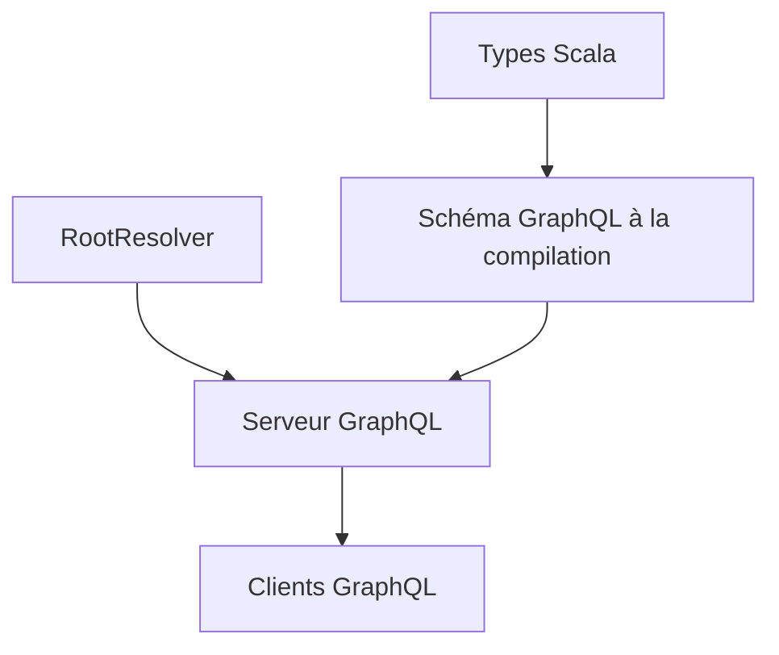

# ghostdogpr/caliban

> Bibliothèque Scala purement fonctionnelle pour construire serveurs et clients GraphQL.

## Le problème
Définir un schéma GraphQL à la main en Scala oblige à écrire beaucoup de code répétitif.

## Ce que ça fait vraiment
Le schéma se dérive à la compilation depuis les types Scala standard ; le résolveur (`RootResolver`) est une simple valeur fournie à l'exécution. Le README affirme peu de code répétitif et des internes optimisés. Il liste une quinzaine d'entreprises utilisatrices, mais aucun exemple de code.

## Comment c'est branché

Schéma simplifié d'après la fiche, sans diagramme fourni.

## Essayer
```bash
# Aucune commande dans le README : voir la documentation en ligne.
```

## Coût et pièges
Gratuit. Écosystème Scala et JVM ; artefact `caliban_3` sur Maven Central.

## Ce que ce n'est pas
Pas un serveur prêt à l'emploi : une bibliothèque à intégrer dans une appli Scala.

## Alternatives
Aucune alternative nommée dans le README.

## Pour toi
Ignorer : GraphQL en Scala ne concerne pas un profil data/IA centré sur Python.

