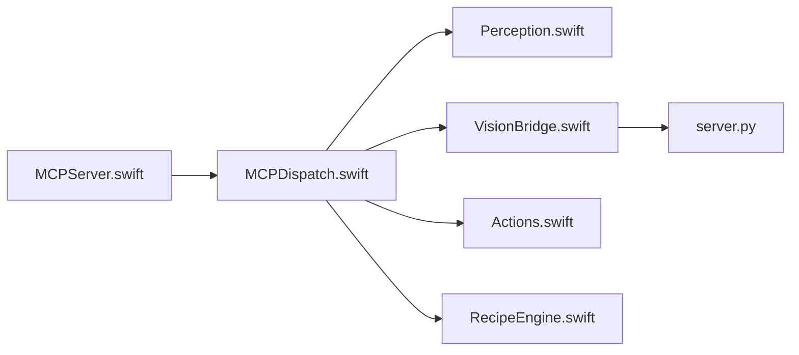

# ghostwright/ghost-os

> MCP server that lets an AI agent see and drive macOS applications through the accessibility tree.

## The problem
A coding agent stays locked inside its chat window: it cannot click, fill in a form or send an email in a real application.

## What it actually does
Exposes 29 MCP tools (context reading, click, typing, drag, windows, waiting) based on the macOS accessibility tree, falling back to a local vision model (ShowUI-2B) for web apps. Workflows are saved as parameterized, replayable JSON "recipes"; a learning mode watches the user through a CGEvent tap and derives a recipe from it. About 7,000 lines of Swift plus a Python sidecar.

## How it is wired


## Trying it
```bash
brew install ghostwright/ghost-os/ghost-os
ghost setup
ghost doctor
```

## Cost and gotchas
macOS 14+ and Swift 6.2+ to build. Accessibility, Screen Recording and Input Monitoring permissions required. The vision model weighs about 3 GB. Last push in March 2026.

## What it is not
Not cross-platform: Mac only. Giving an agent control of all apps is a risk in itself; the README does not detail any safeguards. The reliability figures ("100%") are claims from the README.

## Alternatives
- Anthropic Computer Use and OpenAI Operator: compared in the README (screenshot-based approach).
- OpenClaw: drives the browser DOM only.

## For you
Worth watching: a solid idea (accessibility tree rather than pixels) for automating the Mac, but young, macOS-only and little updated since March.
