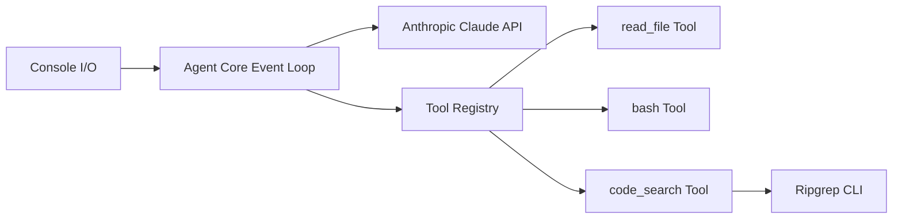

# ghuntley/how-to-build-a-coding-agent

> Six-step Go workshop to build a coding agent on the Claude API.

## The problem
Coding agents seem magical; it is poorly understood that they are just an LLM + tools loop.

## What it actually does
Six progressive Go programs: chat, file reading, listing, bash, editing, ripgrep search.
All share the same loop: input → inference → tool call → result returned → response.
Tools are defined by a name, a JSON schema generated from a Go struct, and a function.
Example files provided (`fizzbuzz.js`, `riddle.txt`).

## How it is wired


## Trying it
```bash
go mod tidy
export ANTHROPIC_API_KEY="your-api-key-here"
go run chat.go
go run edit_tool.go
go run code_search_tool.go
```

## Cost and gotchas
Anthropic key at your expense; Go 1.24.2+ or devenv. The bash tool runs real commands on your machine.

## What it is not
Not an agent usable day to day: no guardrails, no memory. No license declared.

## Alternatives
No alternative named in the README.

## For you
Adopt as a learning resource: an hour is enough to demystify coding agents and extract a skeleton for your own tools.
