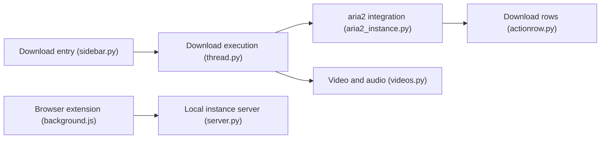

# giantpinkrobots/varia

> GTK download manager for files, torrents and videos, a front end for aria2 and yt-dlp.

## The problem
Managing direct downloads, torrents and video or audio streams in a single application.

## What it actually does
- Front end for aria2 and yt-dlp, with scheduler, notifications, and a notification-area icon.
- File selection within a torrent, Firefox/Chrome browser extension.
- Linux (Flatpak first), Windows; macOS "experimental".
- Automatic updates on the Windows installer.

## How it is wired


## Trying it
```bash
flatpak install flathub io.github.giantpinkrobots.varia
sudo snap install varia
```

## Cost and gotchas
Free. The default branch `next` may not build outside Flatpak. AUR and AppImage packages are unofficial.

## What it is not
Not a scraping tool or a data pipeline.

## Alternatives
No alternative named in the README.

## For you
Ignore: a desktop utility; for data collection, you will call aria2 or yt-dlp directly.
