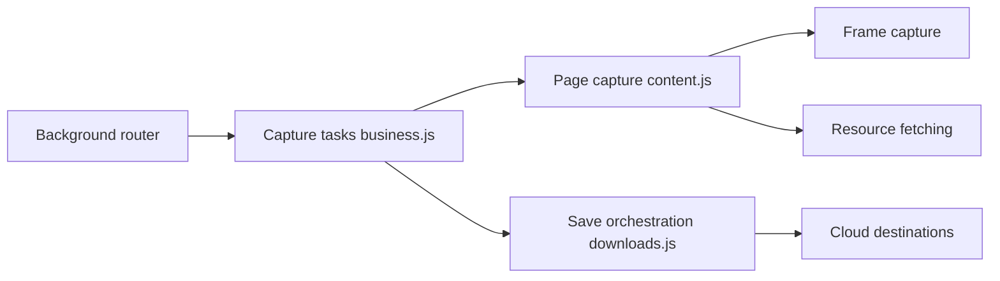

# gildas-lormeau/SingleFile

> Saves a complete web page into a single HTML file, via browser extension or CLI.

## The problem
Saving a page with its images, styles and fonts yields a fragile folder or a poorly portable format.

## What it actually does
One click captures the page (or the selection, frames, several tabs) as minified standalone HTML, self-extracting ZIP or MHTML. Annotation before saving, automatic saving, upload to Google Drive or GitHub, optional blockchain proof of existence. A separate CLI exists (single-file-cli).

## How it is wired


## Trying it
```bash
# Installation via les stores (Firefox, Chrome, Edge, Safari) ; aucune commande requise.
# Raccourci par défaut : Ctrl+Shift+Y pour sauvegarder l'onglet courant.
```

## Cost and gotchas
Free, AGPL-3.0 license (strong copyleft if you embed it in a service). Single main maintainer.

## What it is not
Not a site crawler: one page at a time (or open tabs). The CLI lives in another repository.

## Alternatives
ArchiveBox (self-hosted archiving), Karakeep, linkding, Linkwarden, Readeck: bookmark managers that build on SingleFile.

## For you
Excellent for durably archiving articles and technical docs; adopt it as a personal extension, the license does not get in the way for that use.
