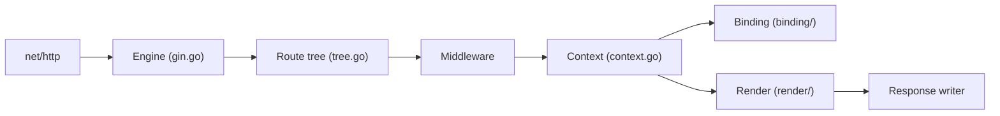

# gin-gonic/gin

> HTTP web framework in Go, for REST APIs and microservices, with routing, middleware, JSON binding and validation.

## The problem
Go's standard library requires repetitive code for routing, middleware, request binding and response rendering.

## What it actually does
A `gin.Default()` engine (with logging and panic recovery), a tree-based router with route groups, a per-request `Context` object, chained middleware, data binding (JSON, XML, YAML, forms, query, headers) with validation, and rendering (JSON, XML, HTML, text). The JSON codec is swappable (stdlib, go-json, jsoniter, sonic).

## How it is wired


## Trying it
```bash
go run main.go
```
The README's `main.go` creates a router, exposes `GET /ping` (response `{"message":"pong"}`) and starts on port 8080.

## Cost and gotchas
Free. The README requires Go 1.26 or later. The README's benchmark figures come from their own measurements (GitHub API routing): redo them on your own case.

## What it is not
Neither a full framework with built-in ORM or authentication (those go through gin-contrib middleware) nor the fastest in its own benchmark table.

## Alternatives
- HttpRouter: the router Gin derives from, 21,360 ns/op versus 27,364 in the README table.
- Aero: 20,648 ns/op in the same table, lower than Gin.

## For you
Ignore: a Go framework, whereas a data/AI profile builds APIs in Python (FastAPI); it is only worth it for taking over a service already written in Go.
