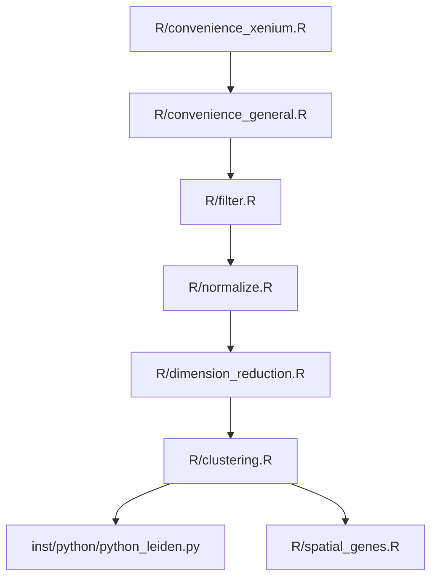

# giotto-suite/Giotto

> Paquet R pour traiter, analyser et visualiser des données spatiales multi-omiques à toutes les échelles.

## Le problème
Les technologies spatiales (Visium, Xenium, MERFISH, CODEX) produisent des formats et des résolutions très différents à analyser ensemble.

## Ce que ça fait vraiment
Giotto Suite importe les données de chaque technologie par des fonctions `convenience_*`, puis filtre, normalise, réduit les dimensions et regroupe les cellules. L'analyse spatiale cherche des gènes et des interactions ; certains algorithmes (Leiden) passent par des scripts Python. Le README renvoie vers un site de documentation, d'exemples et de tutoriels.

## Comment c'est branché


## Essayer
```r
pak::pkg_install("giotto-suite/Giotto")
```

## Coût et pièges
Gratuit. Il faut R ; certains algorithmes demandent Python, et les jeux spatiaux sont lourds en mémoire (non précisé par le README). Licence présente mais non identifiée par GitHub.

## Ce que ce n'est pas
Ce n'est pas un outil généraliste de data science : il cible la biologie spatiale. Le README donne peu d'exemples de code, tout est sur le site.

## Alternatives
Aucune alternative nommée dans le README.

## Pour toi
À surveiller si tu touches à la génomique spatiale en R ; sans ce domaine, il n'a pas d'intérêt.

