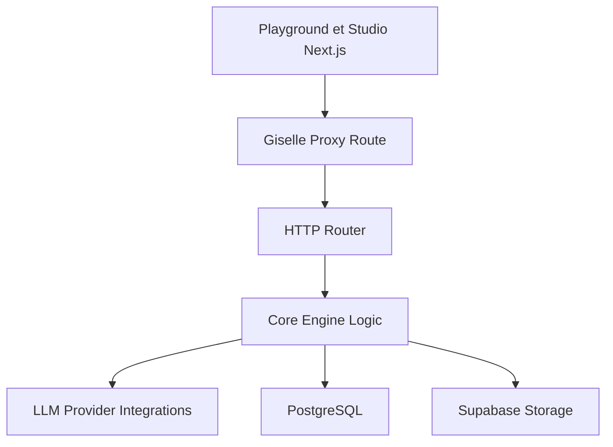

# giselles-ai/giselle

> Open source drag-and-drop studio for AI agent workflows, to self-host.

## The problem
Chaining several models, files and GitHub in a single agent takes a lot of glue. A local visual tool is missing.

## What it actually does
- Visual agent editor, composing OpenAI, Anthropic and Google models.
- Knowledge base with GitHub vector store integration.
- pnpm and Turbo monorepo: two Next.js applications, a `giselle-engine` engine, Supabase and Drizzle for data.
- The hosted cloud service is shut down; only local use remains.

## How it is wired


## Trying it
```bash
git clone https://github.com/giselles-ai/giselle.git
cd giselle
pnpm install
touch .env.local
echo 'OPENAI_API_KEY="your_openai_api_key_here"' >> .env.local
pnpm turbo dev
```

## Cost and gotchas
At least one API key (OpenAI, Anthropic or Google) at your expense. The architecture mentions Supabase, Stripe, Posthog and OpenTelemetry: telemetry must be checked before real use. Teamwork and the template hub are still in development.

## What it is not
Not a hosted service: the cloud is discontinued. Not a ready-to-use tool without an API key.

## Alternatives
No alternative named in the README.

## For you
Worth watching: the visual builder is of interest to an AI profile, but the code carries billing and analytics inherited from the cloud, and the local setup remains to be proven.
