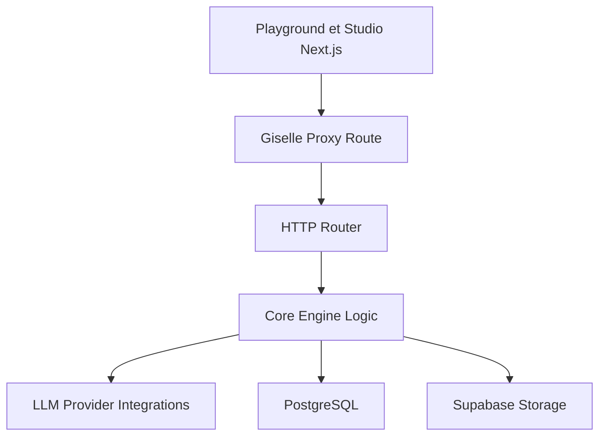

# giselles-ai/giselle

> Studio open source de workflows d'agents IA en glisser-déposer, à héberger soi-même.

## Le problème
Enchaîner plusieurs modèles, des fichiers et GitHub dans un même agent demande beaucoup de colle. Il manque un outil visuel local.

## Ce que ça fait vraiment
- Éditeur visuel d'agents, composition de modèles OpenAI, Anthropic et Google.
- Base de connaissances avec intégration du vector store GitHub.
- Monorepo pnpm et Turbo : deux applications Next.js, un moteur `giselle-engine`, Supabase et Drizzle pour les données.
- Le service cloud hébergé est arrêté ; seul l'usage local reste.

## Comment c'est branché


## Essayer
```bash
git clone https://github.com/giselles-ai/giselle.git
cd giselle
pnpm install
touch .env.local
echo 'OPENAI_API_KEY="your_openai_api_key_here"' >> .env.local
pnpm turbo dev
```

## Coût et pièges
Au moins une clé d'API (OpenAI, Anthropic ou Google) à ta charge. L'architecture mentionne Supabase, Stripe, Posthog et OpenTelemetry : la télémétrie est à vérifier avant un usage réel. Travail d'équipe et hub de templates sont encore en développement.

## Ce que ce n'est pas
Pas un service hébergé : le cloud est discontinué. Pas un outil prêt à l'emploi sans clé d'API.

## Alternatives
Aucune alternative nommée dans le README.

## Pour toi
À surveiller : le constructeur visuel intéresse un profil IA, mais le code porte du billing et de l'analytique hérités du cloud, et la configuration locale reste à éprouver.

