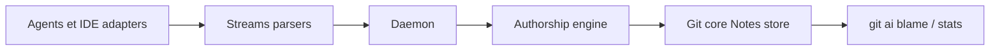

# git-ai-project/git-ai

> Open source git extension that links every line of AI code to the agent, the model and the prompt.

## The problem
Once an agent's code is committed, you no longer know which part is AI, nor which prompt or decisions produced it.

## What it actually does
Agents call `git-ai checkpoint` on every write. At commit time, the line-by-line attribution is stored in Git Notes. It is carried over through rebase, squash, cherry-pick and stash. `git ai blame` replaces `git blame`, `git ai stats` aggregates the AI percentage. No git hooks and no wrapper around the git binary. The Teams version (paid, not detailed) adds a prompt store and metrics.

## How it is wired


## Trying it
```bash
curl -sSL https://usegitai.com/install.sh | bash
git ai install-hooks
git ai blame /src/log_fmt/authorship_log.rs
git ai stats --json
```

## Cost and gotchas
Free CLI, local, no login. Limits: `git mv`, `filter-branch` and `git replace` are not tracked. Squash/rebase on the forge side require the Actions CI or the Teams version.

## What it is not
It does not detect AI by heuristics: it depends on agents declaring their lines. The Teams part is not open.

## Alternatives
No alternative named in the README.

## For you
Watch: useful to measure the share of AI and the cost per PR in a team, but it adds a daemon and depends on each agent's support.
