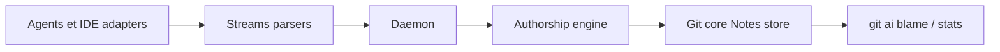

# git-ai-project/git-ai

> Extension git open source qui relie chaque ligne de code IA à l'agent, au modèle et au prompt.

## Le problème
Une fois le code d'un agent commité, on ne sait plus quelle part est IA, ni quel prompt ou quelles décisions l'ont produite.

## Ce que ça fait vraiment
Les agents appellent `git-ai checkpoint` à chaque écriture. Au commit, l'attribution ligne à ligne est stockée dans des Git Notes. Elle est déplacée lors de rebase, squash, cherry-pick, stash. `git ai blame` remplace `git blame`, `git ai stats` agrège le % d'IA. Pas de hooks git ni de wrapper du binaire git. La version Teams (payante, non détaillée) ajoute store de prompts et métriques.

## Comment c'est branché


## Essayer
```bash
curl -sSL https://usegitai.com/install.sh | bash
git ai install-hooks
git ai blame /src/log_fmt/authorship_log.rs
git ai stats --json
```

## Coût et pièges
CLI gratuit, local, sans login. Limites : `git mv`, `filter-branch` et `git replace` ne sont pas suivis. Squash/rebase côté forge exigent les CI Actions ou la version Teams.

## Ce que ce n'est pas
Ne détecte pas l'IA par heuristique : il dépend des agents qui déclarent leurs lignes. La partie Teams n'est pas libre.

## Alternatives
Aucune alternative nommée dans le README.

## Pour toi
Surveiller : utile pour mesurer la part d'IA et le coût par PR dans une équipe, mais il ajoute un daemon et dépend du support de chaque agent.

