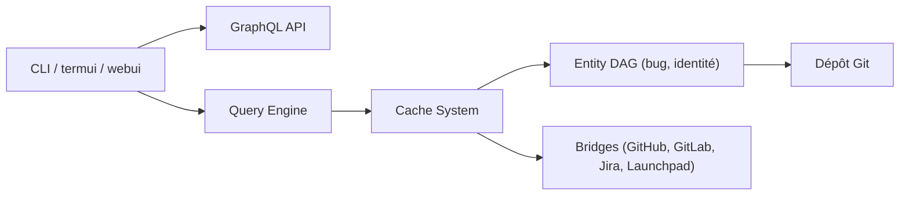

# git-bug/git-bug

> Distributed issue tracker stored in Git, usable offline from the CLI, terminal or web.

## The problem
Issue trackers are external services: lock-in, downtime, no offline access.

## What it actually does
Issues are stored as Git objects, without adding files to the project. You push and pull them (`git bug push`, `git bug pull`) with the remotes. Interfaces: CLI, terminal interface (`termui`), web interface (`webui`, which also serves as a code browser) through a GraphQL API. Bridges import and export to GitHub, GitLab, Jira and Launchpad.

## How it is wired


## Trying it
```bash
git bug user create
git bug add
git bug push [<remote>]
git bug pull [<remote>]
git bug ls "status:open sort:edit"
git bug webui
```

## Cost and gotchas
Free. The web interface is not ready as a public portal (WIP). Installation is detailed in `INSTALLATION.md`, not reproduced here.

## What it is not
Not a full project manager; not a public issue portal for now. The GPL-3.0 imposes copyleft on any modified redistribution.

## Alternatives
No alternative named in the README (it offers bridges to GitHub, GitLab, Jira and Launchpad).

## For you
Watch: an appealing idea for keeping a research repository's issues offline and inside Git, but usage remains marginal and the bridge to team tools needs tuning.
