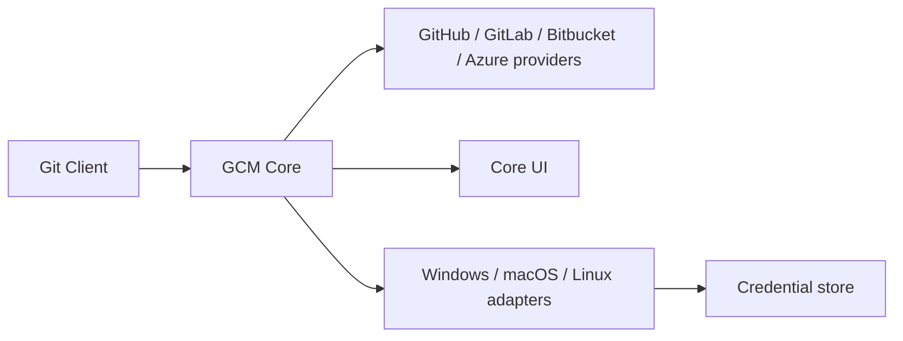

# git-ecosystem/git-credential-manager

> Cross-platform Git credential helper (.NET), with multifactor authentication for the major hosts.

## The problem
Git's built-in helpers only handle username and password; modern authentication (OAuth, MFA) is painful.

## What it actually does
Called implicitly by Git, it opens a sign-in window and stores tokens in the system vault (Windows Credential Manager, macOS keychain, Linux Secret Service). Supports Azure DevOps, Bitbucket, GitHub, GitLab, generic OAuth, proxies. Replaces the older Windows and Mac/Linux managers.

## How it is wired

## Trying it
No command documented in the README (it points to the installation guide); it is not meant to be called directly.

## Cost and gotchas
Free. License "present but unidentified" according to GitHub: to be verified. HTTP(S) only; SSH must be configured separately. Git 2.26.2 is incompatible.

## What it is not
Not a general secrets manager, nor a Git client.

## Alternatives
Git's built-in helpers (wincred, osxkeychain, gnome-keyring/libsecret): simpler but without MFA.

## For you
Adopt: a workstation that pushes to several hosts gains security and comfort for little effort.
