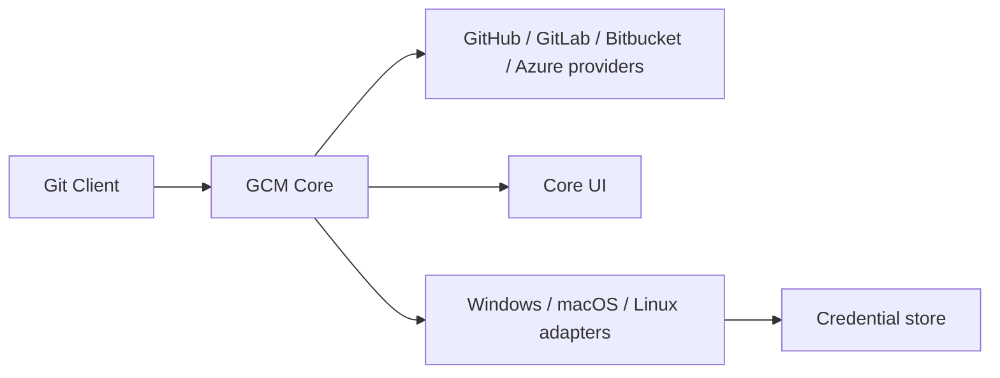

# git-ecosystem/git-credential-manager

> Assistant d'identifiants Git multiplateforme (.NET), avec authentification multifacteur pour les grands hébergeurs.

## Le problème
Les assistants intégrés de Git ne gèrent que nom d'utilisateur et mot de passe ; l'authentification moderne (OAuth, MFA) est pénible.

## Ce que ça fait vraiment
Appelé implicitement par Git, il ouvre une fenêtre de connexion et stocke les jetons dans le coffre du système (Windows Credential Manager, trousseau macOS, Secret Service Linux). Supporte Azure DevOps, Bitbucket, GitHub, GitLab, OAuth générique, proxys. Remplace les anciens gestionnaires Windows et Mac/Linux.

## Comment c'est branché

## Essayer
Aucune commande documentée dans le README (renvoi au guide d'installation) ; il n'est pas destiné à un appel direct.

## Coût et pièges
Gratuit. Licence « présente mais non identifiée » par GitHub : à vérifier. HTTP(S) uniquement ; SSH reste à configurer à part. Git 2.26.2 incompatible.

## Ce que ce n'est pas
Pas un gestionnaire de secrets général, ni un client Git.

## Alternatives
Les assistants intégrés de Git (wincred, osxkeychain, gnome-keyring/libsecret) : plus simples mais sans MFA.

## Pour toi
Adopter : un poste de travail qui pousse vers plusieurs hébergeurs gagne en sécurité et en confort pour peu d'effort.

