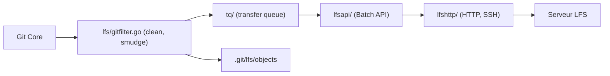

# git-lfs/git-lfs

> Command-line Git extension that stores large files outside the repository and replaces them with pointers.

## The problem
Git handles large binaries (images, datasets, models) poorly: the repository bloats and clones become slow.

## What it actually does
Git filters (clean, smudge, filter-process) replace the large file with a small pointer at commit time and restore it at checkout. Objects are cached under `.git/lfs/objects` and exchanged with an LFS server through a batch API; a parallel transfer queue handles uploads and downloads, with file locking. The `git lfs migrate` command rewrites history to import or export.

## How it is wired


## Trying it
```bash
git lfs install
git lfs track "*.psd"
git add .gitattributes
git commit -m "track *.psd files using Git LFS"
git lfs ls-files
git push origin main
git lfs migrate import --include="*.psd" --everything
```

## Cost and gotchas
Free on the client side, but you need an LFS server (your host's, often with a quota). `migrate` rewrites history and changes all object identifiers. License not identified by GitHub: to be checked. Do not import the Go module as a dependency: no stable API.

## What it is not
Not a data or model versioning tool with metadata, nor a pipeline system; it only offloads large files.

## Alternatives
The README names no alternative.

## For you
Adopt: the standard way to version model weights and large datasets in Git, as long as your host offers enough LFS storage.
