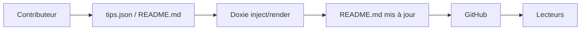

# git-tips/tips

> A collection of Git commands grouped by theme, for anyone who wants ready-to-copy tips.

## The problem
Git has dozens of commands that are hard to remember: cleaning up branches, finding a faulty commit, undoing things cleanly.

## What it actually does
A long README listing tips, each as a title and an `sh` block, grouped by theme: basics, branches, log and history, merge and rebase, remotes, configuration, stash, submodules, tags, undoing. Often with "alternatives". A `git-tip` CLI tool is mentioned separately. The commands are stated as tested on Git 2.7.4 (Apple Git-66).

## How it is wired


## Trying it
```bash
git checkout -
git bisect start
git commit --fixup <SHA-1>
git stash push -m <message>
git worktree add -b <branch-name> <path> <start-point>
```

## Cost and gotchas
Free, nothing to install. Beware of destructive commands (`git reset --hard`, `git clean -f -d`, `git push -f`), which appear without any safeguard. Some tips date from old versions of Git.

## What it is not
Not a tutorial: no explanation of Git's model. It is not a tool, it is a cheat sheet.

## Alternatives
No alternative cited in the README.

## For you
Adopt as a bookmark: any profile that versions code or experiments will find useful reflexes here, at no cost.
