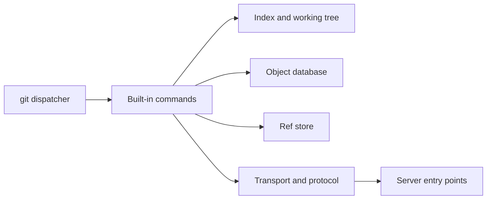

# git/git

> A fast, scalable distributed version control system, for any developer.

## The problem
Tracking the history of code or data, working as a team and merging changes without loss.

## What a simple README is not
The README is short: GPLv2 (some parts under compatible licenses), a mailing list for patches, per-command documentation and tutorials.

## What it actually does
A `git.c` dispatcher routes subcommands to built-in commands. They share APIs over the content-addressed object database (blobs, trees, commits, tags, SHA-1 or SHA-256), the index, the references and the revision algorithm. Local, SSH and HTTP(S) transports; extensible hooks.

## How it is wired

## Trying it
The README gives no command: it points to the `INSTALL` file and to `Documentation/gittutorial.adoc` (`man gittutorial`).

## Cost and gotchas
Free. Built with Make, Meson or CMake, with cURL, OpenSSL, zlib, expat and PCRE2. Patches go through the mailing list, not pull requests.

## What it is not
Not a hosting service: only the local tool and its basic servers.

## Alternatives
No alternative named in the README.

## For you
Adopt: essential for versioning code, notebooks and pipelines; the GPLv2 license is stated in the README text.
