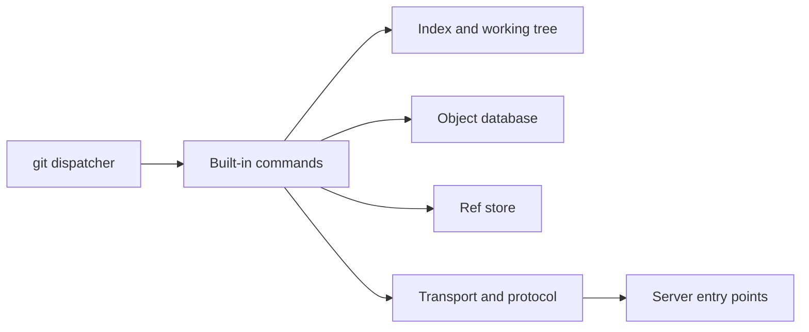

# git/git

> Système de gestion de versions distribué, rapide et évolutif, pour tout développeur.

## Le problème
Suivre l'historique d'un code ou de données, travailler à plusieurs et fusionner les changements sans perte.

## Ce que ce n'est pas d'un simple README
Le README est court : GPLv2 (certaines parties sous licences compatibles), liste de diffusion pour les patchs, documentation par commande et tutoriels.

## Ce que ça fait vraiment
Un dispatcher `git.c` route les sous-commandes vers des commandes intégrées. Elles partagent des API sur la base d'objets adressée par contenu (blobs, arbres, commits, tags, SHA-1 ou SHA-256), l'index, les références et l'algorithme de révision. Transports locaux, SSH, HTTP(S) ; hooks extensibles.

## Comment c'est branché

## Essayer
Le README ne donne pas de commande : il renvoie au fichier `INSTALL` et à `Documentation/gittutorial.adoc` (`man gittutorial`).

## Coût et pièges
Gratuit. Compilation par Make, Meson ou CMake, avec cURL, OpenSSL, zlib, expat et PCRE2. Les patchs passent par la liste de diffusion, non par des pull requests.

## Ce que ce n'est pas
Pas un service d'hébergement : seulement l'outil local et ses serveurs de base.

## Alternatives
Aucune alternative nommée dans le README.

## Pour toi
À adopter : incontournable pour versionner code, notebooks et pipelines ; la licence GPLv2 est indiquée dans le texte du README.

