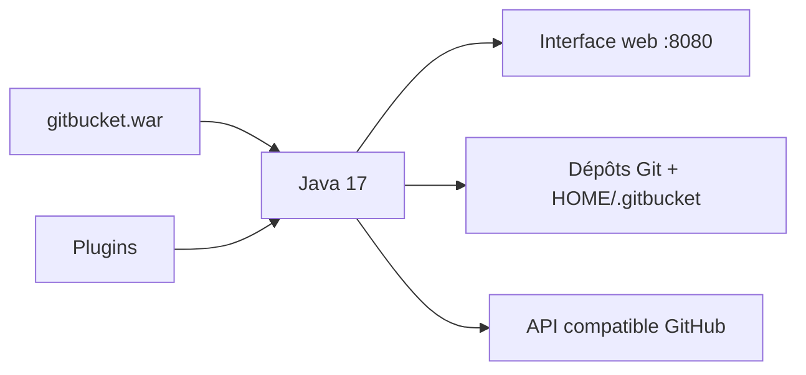

# gitbucket/gitbucket

> Self-hosted Git platform written in Scala, compatible with the GitHub API, installed with a single .war file.

## The problem
Hosting your repositories, issues and pull requests on your own server without a heavy installation.

## What it actually does
Provides public and private repositories (HTTP/HTTPS, SSH), Git LFS, an online file editor, issues, pull requests, a wiki, an activity feed, e-mail notifications, accounts and groups with LDAP, and a plugin system. Data lives in `HOME/.gitbucket`. Versions 4.47 and 4.48 migrate core tables: a backup is advised. The migration from H2 1.x to 2.x is manual.

## How it is wired


## Trying it
```bash
java -jar gitbucket.war
# puis http://[hostname]:8080/  identifiants root / root
```

## Cost and gotchas
Free, Java 17 required. The default credentials `root`/`root` must be changed. Does not support Jakarta EE.

## What it is not
Not a full GitLab: priority goes to simple installation and GitHub compatibility, and requests that go against these may be refused.

## Alternatives
None cited in the README.

## For you
Keep an eye on it: a lightweight option for a private team forge, but your MLOps work will benefit first from a forge with built-in CI.
