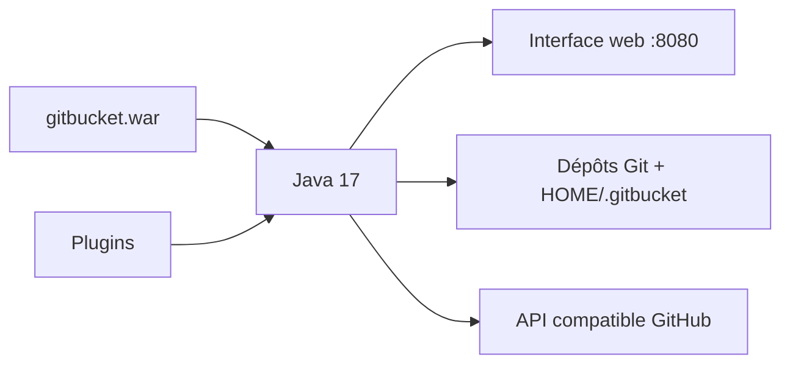

# gitbucket/gitbucket

> Plateforme Git auto-hébergée en Scala, compatible avec l'API GitHub, installée par un simple fichier .war.

## Le problème
Héberger ses dépôts, issues et pull requests sur son propre serveur sans lourde installation.

## Ce que ça fait vraiment
Fournit dépôts publics et privés (HTTP/HTTPS, SSH), Git LFS, éditeur de fichiers en ligne, issues, pull requests, wiki, fil d'activité, notifications par e-mail, comptes et groupes avec LDAP, et un système de plugins. Les données vivent dans `HOME/.gitbucket`. Les versions 4.47 et 4.48 migrent des tables du cœur : sauvegarde conseillée. La migration H2 1.x vers 2.x est manuelle.

## Comment c'est branché


## Essayer
```bash
java -jar gitbucket.war
# puis http://[hostname]:8080/  identifiants root / root
```

## Coût et pièges
Gratuit, Java 17 requis. Les identifiants par défaut `root`/`root` doivent être changés. Ne gère pas Jakarta EE.

## Ce que ce n'est pas
Pas un GitLab complet : priorité à l'installation simple et à la compatibilité GitHub, les demandes contraires peuvent être refusées.

## Alternatives
Aucune citée dans le README.

## Pour toi
Surveiller : option légère pour un forge privé d'équipe, mais ton MLOps profitera d'abord d'un forge qui a de la CI intégrée.

