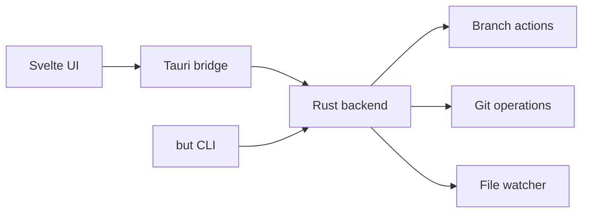

# gitbutlerapp/gitbutler

> Git interface (GUI and `but` CLI) with stacked and parallel branches, for humans and agents.

## The problem
`rebase -i`, branch switching and conflict resolution slow work down and get in the way of coding agents.

## What it actually does
Stacked and parallel branches, commit editing by drag-and-drop or CLI, undo timeline, first-class conflicts (a rebase always succeeds), GitHub/GitLab/Bitbucket integration, AI assistance (commit messages, PR descriptions) and hooks/skills for agents. Tauri/Svelte interface, Rust engine shared with the `but` CLI.

## How it is wired
Diagram not readable in the data provided; diagram based on the described architecture (unverified):

## Trying it
No command in the README: download from the website, online documentation.

## Cost and gotchas
License present but not identified by GitHub: to verify. The AI features go through external services (OpenAI mentioned in the architecture).

## What it is not
Not a replacement for Git: a layer applied on top of an existing repository.

## Alternatives
None named in the README.

## For you
Watch: useful if you orchestrate coding agents that make many commits, otherwise Git is enough; check the license first.
