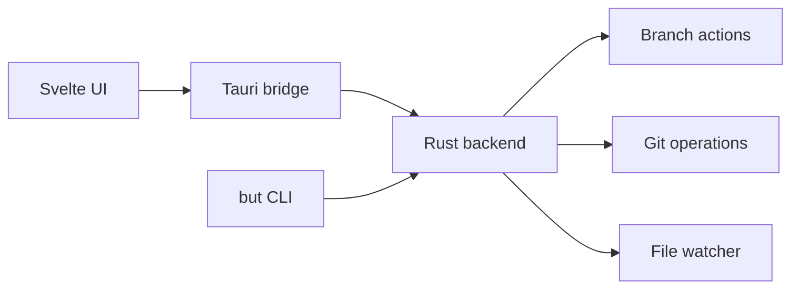

# gitbutlerapp/gitbutler

> Interface Git (GUI et CLI `but`) avec branches empilées et parallèles, pour humains et agents.

## Le problème
`rebase -i`, changement de branche et résolution de conflits ralentissent le travail et gênent les agents de code.

## Ce que ça fait vraiment
Branches empilées et parallèles, édition de commits par glisser-déposer ou CLI, chronologie d'annulation, conflits de premier rang (un rebase réussit toujours), intégration GitHub/GitLab/Bitbucket, aide IA (messages de commit, descriptions de PR) et hooks/skills pour agents. Interface Tauri/Svelte, moteur Rust partagé avec le CLI `but`.

## Comment c'est branché
Diagramme non lisible dans les données fournies ; schéma d'après l'architecture décrite (non vérifié) :

## Essayer
Aucune commande dans le README : téléchargement depuis le site, documentation en ligne.

## Coût et pièges
Licence présente mais non identifiée par GitHub : à vérifier. Les fonctions IA passent par des services externes (OpenAI cité dans l'architecture).

## Ce que ce n'est pas
Pas un remplaçant de Git : une surcouche qui s'applique à un dépôt existant.

## Alternatives
Aucune nommée dans le README.

## Pour toi
Surveiller : utile si tu orchestres des agents de code qui font beaucoup de commits, sinon Git suffit ; vérifie d'abord la licence.

