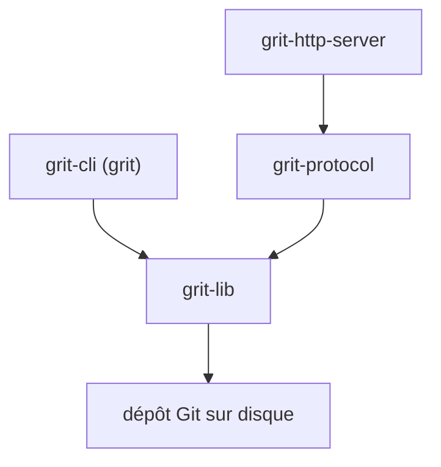

# gitbutlerapp/grit

> Git engine in Rust, with a library and a `grit` client offering human, JSON and Markdown outputs.

## The problem
Command-line Git is slow at scale and hard to embed in other programs.

## What it actually does
`grit-lib` carries objects, diff, index, refs, merges and configuration; `grit-cli` is a simplified client (status as home page, `commit`, `switch`, `push`, `pull`). It also acts as a server (`upload-pack`, `receive-pack`, HTTP). Compatible with Git repositories and protocol; speed is the stated priority. Releases are signed with SSH.

## How it is wired
Simplified diagram based on the fiche, no diagram provided.


## Trying it
```bash
curl -fsSL https://grit-scm.com/install | sh
grit auth
grit clone https://github.com/user/project
grit commit "message"
```

## Cost and gotchas
Free. Rust 1.95 minimum for dependents; the contributor toolchain is pinned to 1.99.0. It is not an identical Git client: several subcommands have been removed. The install script is a `curl | sh`.

## What it is not
It is not a 1:1 replacement for `git`: the compatible CLI (`grit-git`) was removed.

## Alternatives
No alternative named in the README.

## For you
Watch: interesting for the JSON output of a scriptable Git client, still young to replace `git`.
