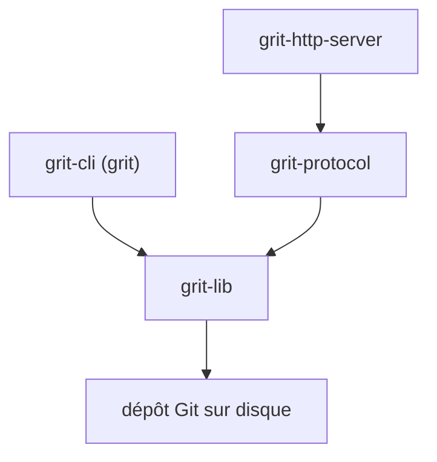

# gitbutlerapp/grit

> Moteur Git en Rust, avec une bibliothèque et un client `grit` à sorties humaines, JSON et Markdown.

## Le problème
Git en ligne de commande est lent à grande échelle et peu embarquable dans d'autres programmes.

## Ce que ça fait vraiment
`grit-lib` porte les objets, diff, index, refs, fusions et configuration ; `grit-cli` est un client simplifié (statut en page d'accueil, `commit`, `switch`, `push`, `pull`). Il sert aussi de serveur (`upload-pack`, `receive-pack`, HTTP). Compatible avec les dépôts et le protocole Git ; la vitesse est la priorité affichée. Releases signées en SSH.

## Comment c'est branché
Schéma simplifié d'après la fiche, sans diagramme fourni.


## Essayer
```bash
curl -fsSL https://grit-scm.com/install | sh
grit auth
grit clone https://github.com/user/project
grit commit "message"
```

## Coût et pièges
Gratuit. Rust 1.95 minimum pour les dépendants ; la chaîne de contributeurs est épinglée en 1.99.0. Ce n'est pas un client Git identique : plusieurs sous-commandes ont été retirées. Le script d'installation est un `curl | sh`.

## Ce que ce n'est pas
Ce n'est pas un remplaçant 1:1 de `git` : le CLI compatible (`grit-git`) a été supprimé.

## Alternatives
Aucune alternative nommée dans le README.

## Pour toi
À surveiller : intéressant pour la sortie JSON d'un client Git scriptable, encore jeune pour remplacer `git`.

