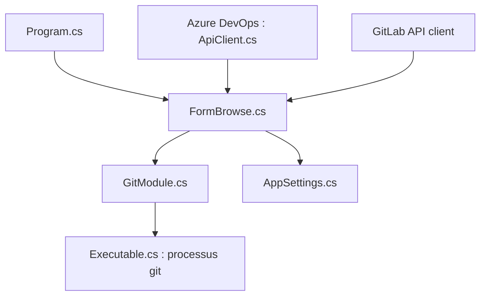

# gitextensions/gitextensions

> Windows graphical interface for managing Git repositories, integrated into Explorer and Visual Studio.

## The problem
The Git command line is hard to read for browsing history, committing changes or resolving conflicts; a graphical interface helps.

## What it actually does
Windows application (.NET 10): repository browser, revision grid, commit window, file viewer, conflict resolution. According to the code, it runs the git program as a subprocess, handles patches, user scripts and shortcuts. Plugins connect Azure DevOps and GitLab for pipeline status.

## How it is wired

## Trying it
No documented command: download the installer, or use Chocolatey or Winget (names cited without a command).

## Cost and gotchas
Free. Windows 10 or later only. Building requires Visual Studio 2026 and .NET 10. License not identified by GitHub, 559 open issues.

## What it is not
It is not cross-platform: the README says "Windows only". It is not a replacement for Git, it is an interface on top of git.

## Alternatives
No alternative named in the README.

## For you
Ignore: Windows only, whereas MLOps work is mostly done in a Linux terminal with git.
