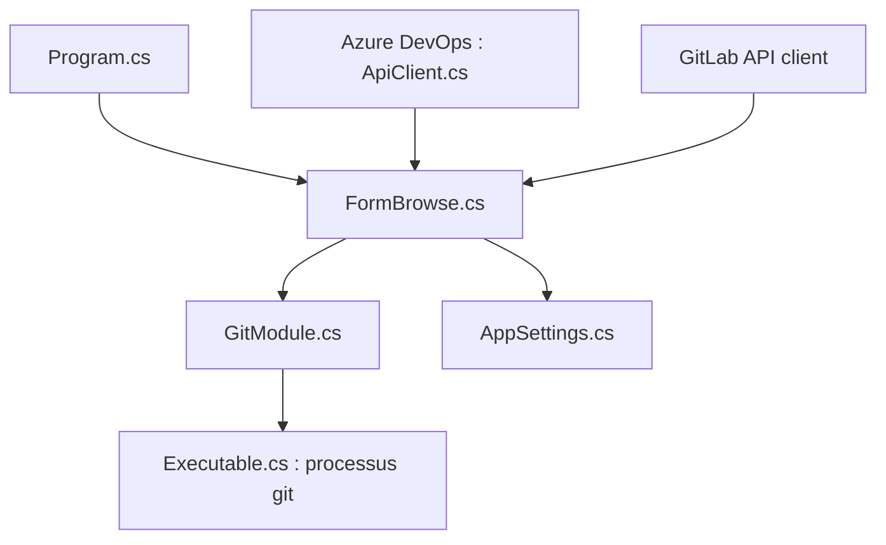

# gitextensions/gitextensions

> Interface graphique Windows pour gérer des dépôts Git, intégrée à l'Explorateur et à Visual Studio.

## Le problème
La ligne de commande Git est peu lisible pour parcourir l'historique, valider des changements ou résoudre des conflits ; une interface graphique aide.

## Ce que ça fait vraiment
Application Windows (.NET 10) : navigateur de dépôt, grille des révisions, fenêtre de validation, visualiseur de fichiers, résolution de conflits. D'après le code, elle exécute le programme git en sous-processus, gère les patchs, des scripts utilisateur et des raccourcis. Des greffons relient Azure DevOps et GitLab pour l'état des pipelines.

## Comment c'est branché

## Essayer
Aucune commande documentée : télécharger l'installateur, ou passer par Chocolatey ou Winget (noms cités sans commande).

## Coût et pièges
Gratuit. Windows 10 ou plus uniquement. Le build demande Visual Studio 2026 et .NET 10. Licence non identifiée par GitHub, 559 issues ouvertes.

## Ce que ce n'est pas
Ce n'est pas multiplateforme : le README dit « Windows only ». Ce n'est pas un remplaçant de Git, c'est une interface au-dessus de git.

## Alternatives
Aucune alternative nommée dans le README.

## Pour toi
À ignorer : réservé à Windows, alors que le travail MLOps se fait surtout en terminal Linux avec git.

