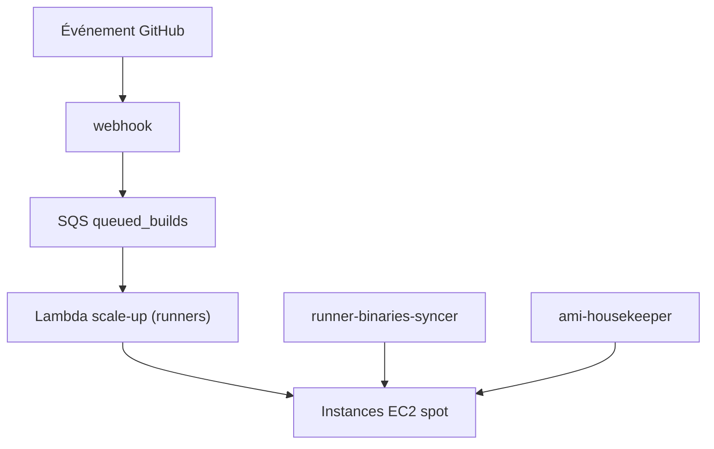

# github-aws-runners/terraform-aws-github-runner

> Terraform module that hosts auto-scaled GitHub Actions runners on AWS spot instances, for platform teams.

## The problem
GitHub-hosted runners are expensive or lack configurability, and fixed runners sit idle.

## What it actually does
A GitHub webhook feeds an SQS queue; Lambda functions create EC2 spot instances on demand and remove them after use (ephemeral runners). The number of runners drops to zero when there are no jobs. Supports custom AMIs, Linux and Windows, multiple runner configurations, GitHub Enterprise Server.

## How it is wired
Simplified diagram based on the sheet, no diagram provided.

## Trying it
The README gives no direct command, only steps: create the AWS account, create a GitHub App, download or build the lambdas, deploy with Terraform, install the application. See the examples folder.

## Cost and gotchas
AWS bill at your expense (EC2, Lambda, SQS, CloudWatch). A GitHub App and Terraform 1.5.6 or later are required. Some options are marked experimental, with no promise of a major version.

## What it is not
Not a turnkey service: you operate the infrastructure. No enterprise-level runners (not supported for now). Maintained "best effort" by the community.

## Alternatives
Not documented in the README.

## For you
Keep an eye on it: useful if you run GPU or heavy CI on AWS and want to control costs, useless without Terraform and AWS already in place.
