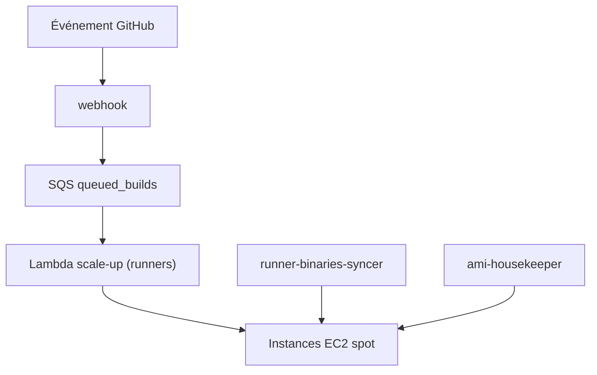

# github-aws-runners/terraform-aws-github-runner

> Module Terraform qui héberge des runners GitHub Actions auto-scalés sur instances spot AWS, pour équipes plateforme.

## Le problème
Les runners hébergés par GitHub coûtent cher ou manquent de configuration, et des runners fixes tournent à vide.

## Ce que ça fait vraiment
Un webhook GitHub alimente une file SQS ; des fonctions Lambda créent des instances EC2 spot à la demande et les retirent après usage (runners éphémères). Le nombre de runners redescend à zéro sans job. Prend en charge AMI personnalisée, Linux et Windows, plusieurs configurations de runners, GitHub Enterprise Server.

## Comment c'est branché
Schéma simplifié d'après la fiche, sans diagramme fourni.

## Essayer
Le README ne donne pas de commande directe, seulement des étapes : créer le compte AWS, créer une GitHub App, télécharger ou construire les lambdas, déployer avec Terraform, installer l'application. Voir le dossier examples.

## Coût et pièges
Facture AWS à ta charge (EC2, Lambda, SQS, CloudWatch). Il faut une GitHub App et Terraform 1.5.6 ou plus. Des options sont marquées expérimentales, sans promesse de version majeure.

## Ce que ce n'est pas
Pas un service clé en main : tu opères l'infrastructure. Pas de runners au niveau entreprise (non pris en charge pour l'instant). Maintenu « au mieux » par la communauté.

## Alternatives
Non documenté dans le README.

## Pour toi
À surveiller : utile si tu gères du CI GPU ou lourd sur AWS et veux maîtriser les coûts, inutile sans Terraform et AWS déjà en place.

