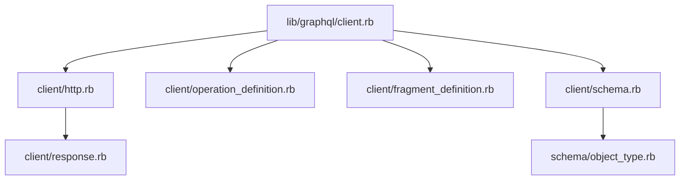

# github-community-projects/graphql-client

> Ruby GraphQL client that declares queries statically and wraps responses in typed objects.

## The problem
Querying a GraphQL API from Ruby with queries built from strings, with no validation against the schema.

## What it actually does
Queries and fragments are written in heredocs and assigned to constants; the client binds them to the schema, runs them through an HTTP adapter and returns structures with Ruby accessors. An ERB extension adds the graphql tag in Rails views.

## How it is wired


## Trying it
```ruby
gem 'graphql-client'
# puis bundle install
result = SWAPI::Client.query(Hero::Query)
result.data.luke.home_planet
```

## Cost and gotchas
Free. The schema is loaded by a network request at startup; it is better to save it in a JSON file.

## What it is not
Not a query builder in Ruby: there is no DSL, only GraphQL syntax. Ruby is not in the list of prerequisites.

## Alternatives
- graphql-ruby: the README says it covers 80% of what this library provides.

## For you
Ignore: a Ruby client, useful only if you write Ruby or Rails.
