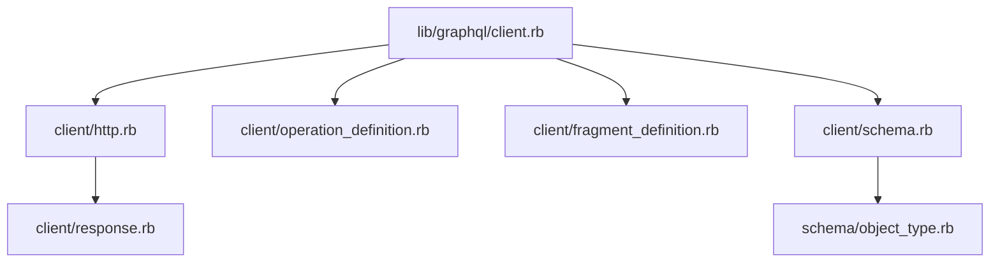

# github-community-projects/graphql-client

> Client GraphQL Ruby qui déclare les requêtes statiquement et enveloppe les réponses dans des objets typés.

## Le problème
Interroger une API GraphQL depuis Ruby avec des requêtes construites par chaînes, sans validation par rapport au schéma.

## Ce que ça fait vraiment
Les requêtes et fragments sont écrits dans des heredocs et assignés à des constantes ; le client les relie au schéma, les exécute via un adaptateur HTTP et renvoie des structures aux accesseurs Ruby. Une extension ERB ajoute la balise graphql dans les vues Rails.

## Comment c'est branché


## Essayer
```ruby
gem 'graphql-client'
# puis bundle install
result = SWAPI::Client.query(Hero::Query)
result.data.luke.home_planet
```

## Coût et pièges
Gratuit. Le schéma se charge par requête réseau au démarrage ; mieux vaut l'enregistrer dans un fichier JSON.

## Ce que ce n'est pas
Pas un générateur de requêtes en Ruby : il n'y a pas de DSL, seulement la syntaxe GraphQL. Ruby n'est pas dans la liste des prérequis.

## Alternatives
- graphql-ruby : le README dit qu'il couvre 80 % de ce que fournit cette bibliothèque.

## Pour toi
Ignorer : un client Ruby, utile seulement si tu écris du Ruby ou du Rails.

