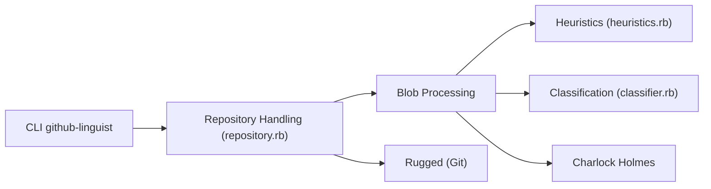

# github-linguist/linguist

> Ruby library that detects the language of a repository's files, used by GitHub for its statistics.

## The problem
Know which languages a repository is made of, ignore binaries and vendored files, and filter out generated code.

## What it actually does
The `github-linguist` CLI reads a Git repository through Rugged and classifies each blob by strategies (file name, extension, heuristics, classifier). It outputs the breakdown as percentages, per file, as JSON, with the strategy used. `.gitattributes` lets you force a language. C extensions (lexer) and a Go grammar tool round it out.

## How it is wired


## Trying it
```bash
gem install github-linguist
cd /path-to-repository
github-linguist
github-linguist --breakdown --json
docker run --rm -v $(pwd):$(pwd):Z -w $(pwd) -t ghcr.io/github-linguist/linguist:latest
```

## Cost and gotchas
Free. Compiling native dependencies (cmake, ICU, libgit2, OpenSSL); the Ruby shipped with Xcode causes problems.

## What it is not
Not a quality or content analyzer: it only names languages. Default results follow GitHub's heuristics.

## Alternatives
No alternative named in the README.

## For you
Worth watching: handy for cataloguing repositories in bulk (what a watch does), but the Ruby installation is heavy for one-off use.
