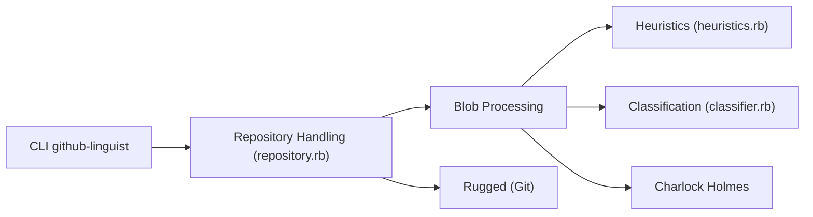

# github-linguist/linguist

> Bibliothèque Ruby qui détecte le langage des fichiers d'un dépôt, utilisée par GitHub pour ses statistiques.

## Le problème
Savoir de quels langages est fait un dépôt, ignorer les binaires et fichiers vendorisés, et filtrer le code généré.

## Ce que ça fait vraiment
La CLI `github-linguist` lit un dépôt Git via Rugged et classe chaque blob par stratégies (nom de fichier, extension, heuristiques, classifieur). Elle sort la répartition en pourcentage, par fichier, en JSON, avec la stratégie retenue. Les `.gitattributes` permettent de forcer un langage. Des extensions C (lexer) et un outil de grammaires en Go complètent le tout.

## Comment c'est branché


## Essayer
```bash
gem install github-linguist
cd /path-to-repository
github-linguist
github-linguist --breakdown --json
docker run --rm -v $(pwd):$(pwd):Z -w $(pwd) -t ghcr.io/github-linguist/linguist:latest
```

## Coût et pièges
Gratuit. Compilation de dépendances natives (cmake, ICU, libgit2, OpenSSL) ; le Ruby fourni par Xcode pose problème.

## Ce que ce n'est pas
Pas un analyseur de qualité ni de contenu : il ne fait que nommer les langages. Résultat par défaut selon les heuristiques de GitHub.

## Alternatives
Aucune alternative nommée dans le README.

## Pour toi
À surveiller : pratique pour cataloguer des dépôts en masse (ce que fait une veille), mais l'installation Ruby est lourde pour un usage ponctuel.

